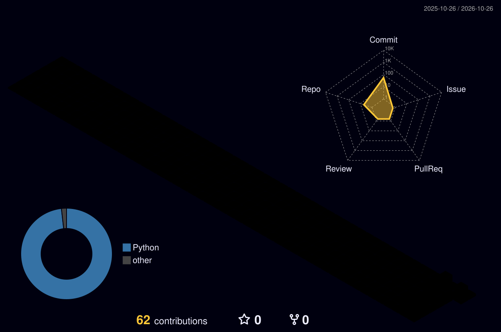

<!-- ==================== HEADER ==================== -->

  

<!-- ==================== PROFILE AND INTRO ==================== -->
<table>
  <tr>
    <td width="27%" valign="top" align="center">
      

      <h2>Krunalsinh Dodiya</h2>
      
<code>@krunalsinhdev</code>

      

        
      

      

        AI/ML Developer 
        B.E. Computer Science Engineering 
        Gujarat, India
      

      

        
         
        
         
        
      

      

      
<strong>Navigation</strong>

      

        <a href="#about-me">👤 About</a> 
        <a href="#tech-stack">⚙️ Tech Stack</a> 
        <a href="#featured-projects">📁 Projects</a> 
        <a href="#contributions">🧊 Contributions</a> 
        <a href="#github-stats">📊 GitHub Stats</a> 
        <a href="#certifications">🏅 Certifications</a> 
        <a href="#contact">✉️ Contact</a>
      

      

      
<strong>Currently learning</strong>

      
Generative AI · LLMs · MLOps

      
<strong>Open to</strong>

      
Internships · Collaborations · Open Source

      

      
<em>“Learn. Build. Improve. Repeat.”</em>

    </td>

    <td width="73%" valign="top">
      <h2 id="about-me">👋 Hello, I'm Krunalsinh</h2>

      

        I'm a Computer Science Engineering student from Gujarat, India,
        passionate about Artificial Intelligence, Machine Learning, and
        building real-world applications.
      

      

        I enjoy learning new technologies, solving problems, and creating
        useful projects with Python, data science, and AI.
      

      

        
        
        
        
      

      <table>
        <tr>
          <td align="center"><strong>🎓 Education</strong> B.E. Computer Science Engineering</td>
          <td align="center"><strong>📍 Location</strong> Gujarat, India</td>
          <td align="center"><strong>🤖 Focus</strong> AI/ML & Data Science</td>
        </tr>
      </table>

      <h3>✨ Areas of Interest</h3>
      

        Machine Learning · Deep Learning · Computer Vision · Natural Language
        Processing · Generative AI · LLMs · MLOps
      

    </td>
  </tr>
</table>

---

<!-- ==================== TECH STACK ==================== -->
<h2 id="tech-stack">⚙️ Tech Stack</h2>

<table>
  <tr>
    <td width="50%" valign="top">
      <h3>💻 Languages</h3>
      
    </td>
    <td width="50%" valign="top">
      <h3>🤖 AI / ML / Data Science</h3>
      
    </td>
  </tr>
  <tr>
    <td width="50%" valign="top">
      <h3>🌐 Web & Frameworks</h3>
      
    </td>
    <td width="50%" valign="top">
      <h3>🛠️ Tools & Cloud</h3>
      
    </td>
  </tr>
  <tr>
    <td colspan="2" valign="top">
      <h3>🗄️ Databases</h3>
      
    </td>
  </tr>
</table>

---

<!-- ==================== PROJECTS ==================== -->
<h2 id="featured-projects">📁 Featured Projects</h2>

  Replace each <code>YOUR-REPO-NAME</code> with the matching repository name.
  The project cards will then show your repository details.

<table>
  <tr>
    <td width="50%" valign="top">
      
      
<strong>🤖 AI Chatbot (RAG)</strong> 
      Document-based chatbot using LLMs and vector search.

      
Python · FastAPI · OpenAI

    </td>

    <td width="50%" valign="top">
      
      
<strong>💗 Disease Prediction System</strong> 
      Machine learning project for health risk prediction.

      
Python · Scikit-learn · Streamlit

    </td>
  </tr>

  <tr>
    <td width="50%" valign="top">
      
      
<strong>🌐 Portfolio Website</strong> 
      Personal portfolio showcasing projects and skills.

      
HTML · CSS · JavaScript

    </td>

    <td width="50%" valign="top">
      
      
<strong>📚 Library Management System</strong> 
      Application for managing library records.

      
Python · MySQL · Flask

    </td>
  </tr>
</table>

---

<!-- ==================== CONTRIBUTIONS ==================== -->
<h2 id="contributions">🧊 3D Contribution Calendar</h2>

Generated by the GitHub Actions workflow below.

  

---

<!-- ==================== GITHUB STATS ==================== -->
<h2 id="github-stats">📊 GitHub Stats</h2>

<table>
  <tr>
    <td width="50%" align="center">
      
    </td>
    <td width="50%" align="center">
      
    </td>
  </tr>
</table>

  <h3>🔥 Contribution Streak</h3>
  

  <h3>📈 Contribution Graph</h3>
  

<!-- ==================== CODING ACTIVITY ==================== -->

  
<strong>⏱️ Coding Activity (WakaTime)</strong>

   
  

    
  

---

<!-- ==================== CERTIFICATIONS ==================== -->
<h2 id="certifications">🏅 Certifications & Achievements</h2>

| Certification | Issuer | Year | Credential |
|:--|:--|:-:|:-:|
| 🧠 Machine Learning Specialization | Coursera / DeepLearning.AI | 2025 | [View](YOUR-CERTIFICATE-LINK-1) |
| 🐍 Python for Data Science | IBM / NPTEL | 2025 | [View](YOUR-CERTIFICATE-LINK-2) |
| ☁️ Cloud Practitioner Essentials | AWS | 2026 | [View](YOUR-CERTIFICATE-LINK-3) |
| 🤖 Generative AI Fundamentals | Google Cloud | 2026 | [View](YOUR-CERTIFICATE-LINK-4) |

---

<!-- ==================== CONTACT ==================== -->
<h2 id="contact">✉️ Contact</h2>

  I'm open to collaborations, internships, and learning opportunities.
  Feel free to reach out.

  
  
  
  

   
  <em>“A small progress every day adds up to big results.”</em>
    
  

